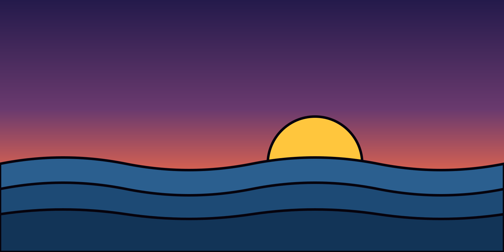

A third post, to fill more than one row of postcards, and to show everything a post can hold.

## The problem

A translation done by hand is one I won't redo after every fix. The trigger is a `pre-commit` hook run by lefthook.

> Drafts are never translated: I translate once, when I publish.

### The script

```ts
// Une traduction est périmée quand l’empreinte ne correspond plus.
export function isStale(post: string, translation: { sourceHash: string }): boolean {
  return translation.sourceHash !== sha256(post);
}

const note =
  'Une très longue ligne de code ne revient jamais à la ligne, même sur un téléphone de quatre cents pixels.';
```


